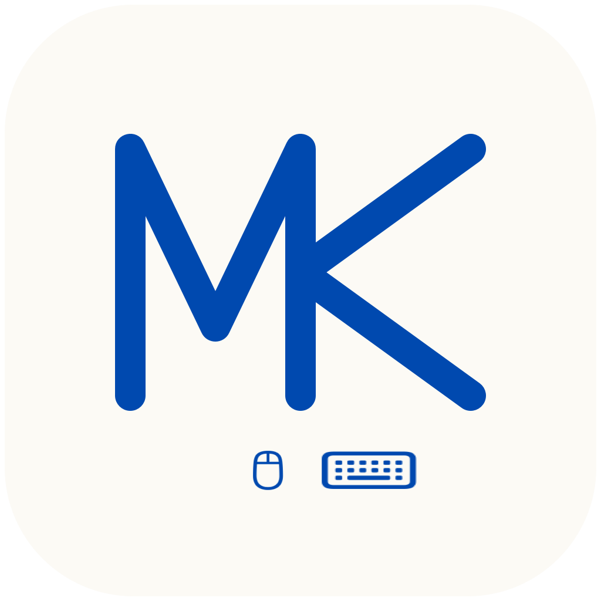

# showMK

在 macOS 菜单栏查看一台蓝牙鼠标和一台蓝牙键盘是否已连接。  
See whether your Bluetooth mouse and keyboard are connected, right in the macOS menu bar.

## 版本 / Versions

- **[v0.2.1 · showMK Notify](showMK-Notify/README.md)** — 在菜单栏状态基础上，设备接入／移出时在屏幕中下部弹出系统风格 HUD 提示；弹窗可在「设置 → 弹窗提示」开关。（最新 / latest）
- **v0.1（本目录）** — 仅菜单栏连接状态，无弹窗提示。源码与分发包见下方及 [v0.1 Release](https://github.com/ontm/showMK/releases/tag/v0.1)。

| 分发包 / Archive | 架构 / CPU | 最低系统 / Minimum macOS |
| --- | --- | --- |
| `showMK-macOS-universal.zip` | Apple Silicon + Intel | 14.0 |
| `showMK-Intel-macOS-12.4.zip` | Intel (x86_64) | 12.4 |

## 使用与构建

解压适合的 ZIP，把 `showMK.app` 移入「应用程序」并打开。点击菜单栏图标，在「设置 → 绑定」选择鼠标和键盘。符号变暗表示未连接。状态每 3 秒刷新，也可选「立即刷新」。应用只读取本机蓝牙状态，不读取输入、不控制连接、不上传数据。绑定保存在用户偏好中；本机日志 `~/Library/Logs/BTStatusBar.log` 可能包含设备标识，请勿直接公开。

安装兼容的 Xcode 命令行工具后，在源码根目录运行 `./build.sh`，生成通用版 `showMK.app`。`./build.sh intel-12.4` 需要支持该目标的 Swift 工具链，输出到 `dist/intel-12.4/showMK.app`。可选的 `./install-autostart.sh` 会**重新构建通用版**、替换 `~/Applications/showMK.app` 并注册当前用户的登录启动项；使用预编译包不需要运行它。正式图标已随源码提供，若要从 PNG 重新生成，请运行 `./design/generate-icon.sh`。

两个包均为 ad-hoc 签名，未使用 Developer ID 签名，也未经 Apple 公证；首次打开时 macOS 可能阻止运行。只打开来源可信的副本。本次核查架构、最低系统版本、图标和签名，不代表目标机运行测试。Intel 包沿用此前报告已在 Intel 实机验证的二进制，更新图标后重新签名；最终两包尚未在各自最低系统上复测。

## Use and build

Unzip the archive for your Mac, move `showMK.app` to Applications and open it. Click the menu bar icon, then **设置 → 绑定** (Settings → Bind) to choose a mouse and keyboard. A dim symbol means disconnected. Status refreshes every three seconds or when you choose **立即刷新** (Refresh now). The app reads local Bluetooth status only: it does not capture input, control connections or upload data. Bindings are stored in user preferences. The local log at `~/Library/Logs/BTStatusBar.log` may contain device identifiers; redact it before sharing.

With compatible Xcode Command Line Tools installed, run `./build.sh` from the source directory to produce the universal `showMK.app`. `./build.sh intel-12.4` requires a Swift toolchain supporting that target and writes to `dist/intel-12.4/showMK.app`. The optional `./install-autostart.sh` rebuilds the **universal** app, replaces the copy in `~/Applications` and registers a per-user login agent. It is not needed for either prebuilt ZIP. To regenerate the bundled icon from the official PNG, run `./design/generate-icon.sh`.

Both archives are ad-hoc signed, not Developer ID signed or notarized. macOS may block first launch; open only copies you trust. Architecture, deployment target, icon and signature checks are static checks. The Intel archive reuses a binary previously reported to work on Intel hardware, re-signed with the new icon. Neither final archive has been runtime-tested on its minimum OS in this release pass.

## 许可 / License

沿用项目此前选择的 [MIT 许可证](LICENSE)。 / This project retains its original [MIT License](LICENSE).
