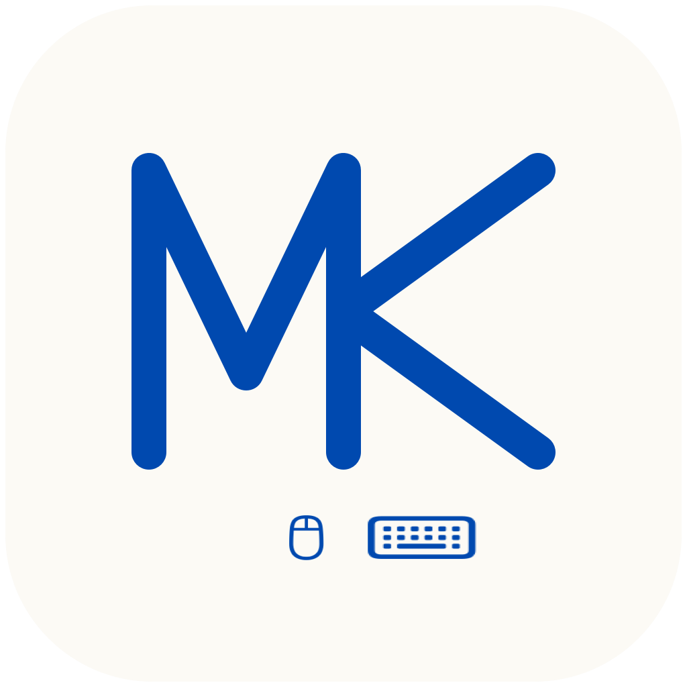

# showMK Notify

v0.2 独立版本。在 v0.1 的菜单栏连接状态基础上，增加设备接入／移出时的屏幕提示。



在 macOS 菜单栏查看一台蓝牙鼠标和一台蓝牙键盘的连接状态；当绑定的设备连接或断开时，在屏幕中下部弹出类似系统 HUD 的提示。

See whether your Bluetooth mouse and keyboard are connected in the macOS menu bar, with a system-style HUD notification when either device connects or disconnects.

## 功能

- 菜单栏图标持续显示绑定鼠标／键盘的连接状态：实心为已连接，线框为未连接。
- 设备接入或移出时在屏幕中下部弹出放大的毛玻璃提示卡，2.6 秒后自动淡出。
- 鼠标与键盘同时变化时合并为一张卡，不叠加窗口。
- 蓝牙关闭只提示一次「蓝牙已关闭」，不逐台误报断开。
- 设置 → 绑定 可选择要监控的鼠标和键盘；设置 → 弹窗提示 可开启／关闭弹窗（默认开启）；「测试提示效果」可手动预览。

## 系统要求

- universal 构建：macOS 14.0 及以上，支持 Apple Silicon 与 Intel。
- 数据来自 `system_profiler SPBluetoothDataType`，无需蓝牙隐私授权、无需辅助功能权限。
- 应用采用临时签名（ad-hoc），未公证。下载后首次打开可能需要在「系统设置 → 隐私与安全性」中允许。

## 使用

从 Releases 下载 ZIP，解压后把 `showMK-Notify.app` 拖到「应用程序」并打开即可。首次运行会自动绑定当前已连接的鼠标和键盘。

菜单栏图标 → 设置 → 绑定 → 鼠标／键盘，可更换监控对象。

## 构建

需要 macOS 与 Swift 命令行工具：

```bash
./build.sh universal          # arm64 + x86_64 通用版
./build.sh intel-12.4         # 仅 Intel x86_64 / macOS 12.4（需对应机器本机编译）
```

离线自检（验证状态差分、去抖、合帧、蓝牙开关等逻辑，不需要真实设备）：

```bash
swiftc Sources/showMKNotify/main.swift -target arm64-apple-macos14.0 \
  -framework AppKit -o /tmp/showmk-selftest
/tmp/showmk-selftest --selftest
```

调试参数：

- `--dump`：打印当前采样结果后退出。
- `--test-hud`：启动时显示一条示例提示。
- `--render-icon [路径]`：生成菜单栏状态图标预览。

## 安装为开机自启

```bash
./install-autostart.sh
```

脚本会安装到 `~/Applications/showMK-Notify.app`，并写入 LaunchAgent `local.rokulab.showmk.notify.plist`。它会停止旧的 showMK-Notify 进程，但不会改动 v0.1 的 showMK 安装或启动项。

## 与 v0.1 的关系

这是完全独立的版本：独立目录、独立 bundle ID `local.rokulab.showmk.notify`、独立应用名与启动项。v0.1 的源码、安装包、偏好设置与 GitHub Release 均不受影响。两个版本可同时安装。

## 验证边界

- 已在 Apple Silicon 开发机验证：通用架构（arm64 + x86_64，最低 macOS 14.0）、签名、`--dump` 采样、离线自检 9 项、提示窗口实拍（含圆角阴影修复）。
- 已在真实 Intel Mac / macOS 12.4 验证：本机编译 x86_64（minos 12.4）、静态检查、离线自检 9 项、7 项兼容点逐项实测、HUD 实拍。Intel 机的 Swift 5.3 兼容降级与圆角阴影修复已合并进本版本。
- 尚未验证：真实设备插拔触发的端到端流程（需在两台 Mac 上切换外设确认）；绑定菜单与弹窗开关的 GUI 点击自动化。
- **已知差异**：v0.2.1 的 Intel/macOS 12.4 预编译包由 Intel 机在本机编译于步骤②，其时源码的蓝牙总状态图标仍使用 `bluetooth` 符号；开发机步骤③将其替换为 macOS 通用可用的 `antenna.radiowaves.left.and.right` 符号（universal 包已含此修复）。因此该 Intel 包在 HUD 的蓝牙总状态图标上可能与当前源码不一致。如需该图标一致，请在 Intel/macOS 12.4 机器上用当前源码重新编译。

## 许可

MIT，见 [LICENSE](LICENSE)。
